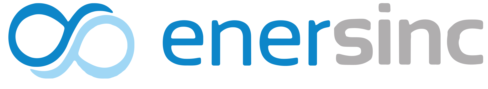

# ENERSINC Harness

<p align="center">
  
  
</p>

**El asistente de IA especializado en regulación energética colombiana (CREG)** para el equipo de ENERSINC. Basado en DeepSeek Harness, congelado y extendido con marca corporativa y capacidad CREG nativa.

---

## 🎯 Qué es y por qué genera valor para ENERSINC

> **En una frase:** *Acceso inmediato, privado y trazable al conocimiento regulatorio oficial de la CREG, con la identidad visual de ENERSINC y sin depender de terceros.*

| Problema del equipo | Cómo lo resuelve ENERSINC Harness |
|---------------------|-----------------------------------|
| **Buscar en la web de la CREG es lento y disperso** | Un chat que consulta **directamente el asistente de IA oficial de la CREG** — respuestas en segundos, con cita de norma/resolución |
| **Riesgo de alucinaciones con LLMs genéricos** | **Fuente primaria única**: solo CREG. Si no está ahí, el asistente dice "no lo sé" en vez de inventar |
| **Datos sensibles saliendo a APIs externas** | **Todo corre en tu máquina**: servicio CREG en `localhost:3100`, llave DeepSeek en `.env` local, cero telemetría |
| **Curva de aprendizaje para no técnicos** | Interfaz web **estilo WhatsApp** — cero entrenamiento, pregunta como se lo harías a un compañero |
| **Automatizar consultas repetitivas** | CLI `run.sh` + perfiles `enersinc-cli` para scripts, reportes, pipelines |
| **Identidad de herramienta propia** | Logo **ENERSINC junto a DeepSeek** en la barra superior — el equipo reconoce "su" herramienta al instante |
| **Mantenimiento y rotura por actualizaciones** | Harness **congelado en `dsh.lock`** (tag `dsh-v0.2.1-alpha.2`) — actualizas cuando *tú* decides, probando antes |
| **Dependencia de un proveedor/consultor** | **Código abierto (MIT)**, instalable en cualquier máquina del equipo, cada quien con su llave DeepSeek |

---

## ✨ Ventajas clave

| Ventaja | Qué significa para ti |
|---------|----------------------|
| **Fuente oficial** | Consulta **directamente** el asistente de IA de la CREG — nada de alucinaciones ni datos inventados |
| **Privacidad local** | Tu llave DeepSeek y tus preguntas **nunca salen de tu máquina** (servicio CREG corre en `localhost:3100`) |
| **Cero configuración** | Un comando instala todo: harness, marca, servicio CREG, perfiles y skill |
| **Multiplataforma real** | Igual en Windows, macOS y Linux (Debian/Ubuntu/Arch/Fedora) — usa Node.js, no shells específicos |
| **Versión congelada** | DeepSeek Harness fijado en `dsh-v0.2.1-alpha.2` (`dsh.lock`) — no se rompe por actualizaciones sorpresivas |
| **Marca corporativa** | Logo ENERSINC junto a DeepSeek en la UI — identifica la herramienta del equipo al instante |
| **Dos interfaces** | Web (chat estilo WhatsApp) **y** terminal (para scripts/automatización) |
| **Modo `direct` por defecto** | Consulta la API de la CREG **sin Chromium** — rápido (~12-20s) y ligero |
| **Diagnóstico incluido** | `doctor.sh` verifica requisitos, build, marca y CREG en segundos |
| **Extensible** | Arquitectura de plugins + skills — añade más capacidades sin tocar el núcleo |

---

## ⚠️ Advertencias y limitaciones

| Tema | Detalle |
|------|---------|
| **Solo regulación colombiana (CREG)** | No sabe de otras jurisdicciones, ni de mercado europeo, ni de temas legales generales |
| **Dependencia de la CREG** | Si el asistente de la CREG cae o cambia su API, el servicio deja de funcionar |
| **Primera instalación lenta** | Descarga y compila el harness (~5-10 min la primera vez); posteriores son instantáneas |
| **Node.js ≥ 22 obligatorio** | En Linux necesitas `build-essential` para compilar dependencias nativas |
| **Puerto 3100** | El servicio CREG usa `:3100` (el 3000 suele estar ocupado); asegúrate de que esté libre |
| **Llave DeepSeek requerida** | Necesitas una cuenta DeepSeek con créditos; la clave se guarda **solo en tu `.env` local** |
| **No es asesoría legal** | Las respuestas son informativas; valida con área legal antes de decisiones críticas |

---

## 💡 Tips y buenas prácticas

| Situación | Recomendación |
|-----------|---------------|
| **Preguntas repetidas** | La caché ignora mayúsculas/espacios — repetir la misma pregunta sale instantáneo |
| **Timeout (504)** | Vuelve a enviar **exactamente la misma pregunta**; el servicio reintenta automáticamente |
| **Preguntas complejas** | Una pregunta por llamada; si necesitas varias, hazlas en mensajes separados |
| **Verificar servicio** | `curl http://127.0.0.1:3100/health` antes de preguntar si algo falla |
| **Actualizar harness** | Edita `dsh.lock` (tag + commit), corre `./scripts/setup.sh` y vuelve a probar `creg_*` |
| **Sin interfaz gráfica (servidor)** | Usa `enersinc-cli` / `run.sh` — funciona 100% headless |
| **Cambiar modo CREG** | `CREG_MODE=auto ./scripts/run.sh "..."` (prueba API y cae a navegador si falla) |
| **Equipo nuevo** | Comparte solo el comando de instalación; cada quien pone su llave DeepSeek |

---

## 🏁 Conclusión

ENERSINC Harness es la **capa de producto** que tu equipo necesita para consultar regulación energética colombiana con confianza:

- **Instalación de una línea** → listo en minutos
- **Fuente primaria (CREG)** → respuestas trazables, no inventadas
- **Marca propia** → identificación visual inmediata en la UI
- **Arquitectura sólida** → harness congelado + overlays idempotentes + CI automatizado
- **Para desarrolladores y no desarrolladores** → interfaz web tipo chat + CLI para automatización

> **Próximos pasos:** Ejecuta el comando universal, pega tu llave DeepSeek y pregunta: *"¿Qué es el Mecanismo de Sostenimiento de la Confiabilidad?"*

---

## 🚀 Instalación rápida (una sola vez)

### Requisitos previos

**Node.js ≥ 22** (recomendado 24 LTS) y **Git**.

#### Instalación por terminal

| OS | Node.js | Git |
|----|---------|-----|
| **Windows (PowerShell)** | `winget install OpenJS.NodeJS.LTS` | `winget install Git.Git` |
| **macOS (Homebrew)** | `brew install node@24` | `brew install git` |
| **Linux (Debian/Ubuntu)** | `curl -fsSL https://deb.nodesource.com/setup_24.x \| sudo -E bash - && sudo apt install -y nodejs` | `sudo apt update && sudo apt install -y git` |
| **Linux (Arch)** | `sudo pacman -S nodejs npm` | `sudo pacman -S git` |
| **Linux (Fedora)** | `sudo dnf install nodejs` | `sudo dnf install git` |

> **Nota:** En Windows, si `winget` no está disponible, descarga los instaladores de [nodejs.org](https://nodejs.org) y [git-scm.com](https://git-scm.com).

```bash
# Verifica que los tienes
node -v && git --version
# Debe mostrar algo como: v24.x.x  y  git version 2.x.x
```

### Comando universal (Windows, macOS, Linux)

```bash
node -e "fetch('https://raw.githubusercontent.com/gamejia/enersinc-harness/main/install.cjs').then(r=>r.text()).then(t=>eval(t)).catch(e=>{console.error(e.message);process.exit(1)})"
```

> **¿Por qué Node y no `curl | sh`?** Porque `sh` no existe en Windows y PowerShell no existe en Linux/Mac. Node.js ya es requisito del asistente.

El instalador:
1. Clona el repo en `~/.enersinc-harness`
2. Descarga y compila DeepSeek Harness (versión congelada `dsh-v0.2.1-alpha.2`)
3. Aplica la marca ENERSINC en la interfaz web
4. Instala el servicio CREG local
5. Crea perfiles `enersinc` (web) y `enersinc-cli` (headless) con CREG activo
6. **Te pide tu llave DeepSeek** (empieza con `sk-`), **la escribe por ti en un archivo `.env` local** — no tienes que crear ni editar nada.

---

## 💬 Uso diario

### Abrir la interfaz web (estilo chat)

```bash
# macOS / Linux
~/.enersinc-harness/scripts/web.sh

# Windows (PowerShell)
powershell -ExecutionPolicy Bypass -File $env:USERPROFILE\.enersinc-harness\scripts\web.ps1
```

Se abre el navegador en `http://localhost:3000`. Verás el logo **🐳 DeepSeek Harness │ ENERSINC** en la barra superior.

### Pregunta única en terminal

```bash
# macOS / Linux
~/.enersinc-harness/scripts/run.sh "¿Qué es el Mecanismo de Sostenimiento de la Confiabilidad?"

# Windows
powershell -ExecutionPolicy Bypass -File $env:USERPROFILE\.enersinc-harness\scripts\run.ps1 "¿Qué es el cargo por confiabilidad?"
```

---

## 🎯 Qué puedes preguntar

El asistente consulta **exclusivamente** al asistente de IA oficial de la **CREG** (Comisión de Regulación de Energía y Gas de Colombia). No inventa respuestas.

| Tema | Ejemplos |
|------|----------|
| **Confiabilidad** | "¿Qué es el Mecanismo de Sostenimiento de la Confiabilidad?"<br>"Explícame el cargo por confiabilidad y cómo se liquida" |
| **Tarifas** | "¿Qué dice la CREG sobre tarifas residenciales?"<br>"¿Cómo se calcula la tarifa de opción regulada?" |
| **Comercialización** | "Resume la última resolución sobre comercialización de energía"<br>"¿Qué requisitos pide la CREG para ser comercializador?" |
| **Normativa general** | "¿Qué resoluciones de 2024 afectan a generadores?"<br>"Diferencia entre agente del mercado y usuario regulado" |

> Si la CREG no tiene información sobre algo, el asistente te lo dice honestamente.

---

## 🔧 Comandos útiles

| Acción | Comando |
|--------|---------|
| Cambiar/actualizar tu llave DeepSeek (te la pide y actualiza `.env`) | `~/.enersinc-harness/scripts/setup-key.sh` |
| Diagnóstico completo (requisitos, build, marca, CREG) | `~/.enersinc-harness/scripts/doctor.sh` |
| Ver logs del servicio CREG | `curl http://127.0.0.1:3100/health` |

---

## 🏗 Arquitectura (para el área técnica)

```
┌─────────────────────────────────────────────────────────────┐
│                    ENERSINC Harness                         │
├─────────────────────────────────────────────────────────────┤
│  DeepSeek Harness (congelado)  │  Overlays ENERSINC         │
│  vendor/deepseek-harness       │  • branding/ (plugin UI)   │
│  tag: dsh-v0.2.1-alpha.2       │  • packages/dsh-bundle-creg│
│  commit: d743267               │  • services/creg/ (Express)│
└────────────────────────────────┴────────────────────────────┘
```

| Capa | Ubicación | Qué hace |
|------|-----------|----------|
| **Congelamiento** | `dsh.lock` | Fija tag + commit del harness probado |
| **Marca UI** | `branding/` + `scripts/brand/` | Plugin cliente: logo ENERSINC en `sidebar.brand.name` |
| **CREG nativo** | `packages/dsh-bundle-creg/` | Bundle Cordis: `creg_ask`, `creg_health`, `creg_stats` |
| **Servicio CREG** | `services/creg/` | Express en `:3100`, modo `direct` (sin Chromium) |
| **Skill** | `skills/uso-de-creg/` | Enseña al modelo cuándo y cómo usar las tools |
| **Orquestación** | `install.cjs`, `scripts/setup.cjs` | Instalación multiplataforma en Node |

### Perfiles creados

| Perfil | Uso | CREG |
|--------|-----|------|
| `enersinc` | Interfaz web (`dsh web`) | Bundle nativo |
| `enersinc-cli` | Headless / scripts | Bundle nativo |

### Variables de entorno

| Variable | Default | Descripción |
|----------|---------|-------------|
| `DEEPSEEK_API_KEY` | — | Llave del modelo (se guarda en `.env`) |
| `CREG_URL` | `http://127.0.0.1:3100` | URL del servicio CREG |
| `CREG_MODE` | `direct` | `direct` \| `auto` \| `browser` |
| `DSH_CLIENT_TITLE` | `ENERSINC Harness` | Título de la pestaña del navegador |
| `ENERSINC_SKIP_BRAND` | `0` | `1` = no aplicar marca |

---

## 📚 Documentación técnica

- [`docs/ARCHITECTURE.md`](docs/ARCHITECTURE.md) — Piezas, flujo de instalación, determinismo
- [`docs/BRANDING.md`](docs/BRANDING.md) — Cómo se integra el logo ENERSINC (slots de cliente)
- [`docs/CREG.md`](docs/CREG.md) — Servicio, endpoints, modos, integración nativa y MCP
- [`services/creg/README.md`](services/creg/README.md) — Cliente CREG standalone
- [`skills/uso-de-creg/SKILL.md`](skills/uso-de-creg/SKILL.md) — Instrucciones para el modelo

---

## ✅ Verificación y CI

```bash
# Verificaciones locales (sintaxis, generador de logo, overlay idempotente)
bash scripts/ci-check.sh

# Diagnóstico del entorno instalado
./scripts/doctor.sh
```

GitHub Actions ejecuta `ci-check.sh` en cada push a `main`.

---

## 🐛 Solución de problemas

| Síntoma | Solución |
|---------|----------|
| `"no pude levantar el servicio CREG"` | Cierra y vuelve a abrir con `web.sh` / `run.sh` |
| `"falta tu llave"` / no responde | Ejecuta `setup-key.sh` y pega tu llave `sk-...` |
| Te cambió la llave | Ejecuta `setup-key.sh` con la nueva |
| Cualquier otra cosa | Ejecuta `doctor.sh` y envía la salida a soporte |

---

## 📦 Requisitos del sistema

| Componente | Mínimo | Nota |
|------------|--------|------|
| Node.js | ≥ 22 | LTS 24 recomendado |
| Git | Cualquier versión | |
| **Linux** | `build-essential` | Si falla la compilación: `sudo apt update && sudo apt install -y build-essential` |

---

## 📄 Licencia

[MIT](LICENSE). El logo ENERSINC es marca de ENERSINC. "DeepSeek Harness" es marca de DeepSeek; este es un proyecto independiente de ENERSINC, no afiliado ni patrocinado por DeepSeek.

---

## 🔗 Enlaces

- **ENERSINC** → [https://enersinc.com](https://enersinc.com)
- **DeepSeek Harness** → [github.com/deepseek-ai/deepseek-harness](https://github.com/deepseek-ai/deepseek-harness)
- **CREG (regulador colombiano)** → [www.creg.gov.co](https://www.creg.gov.co)